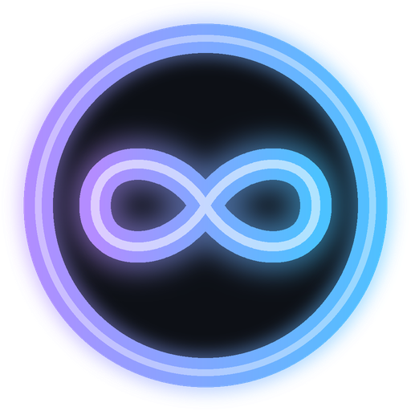
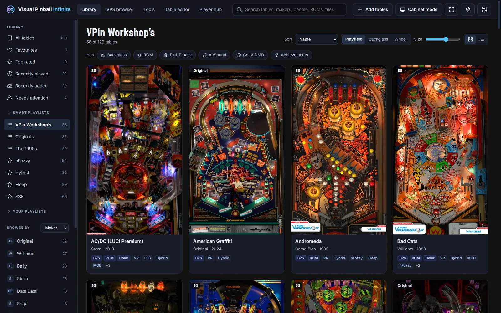
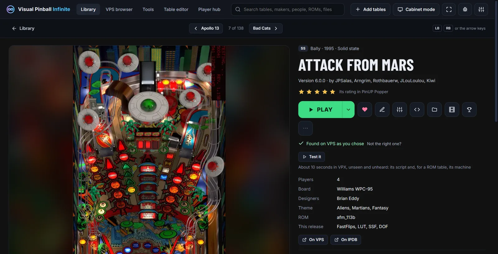
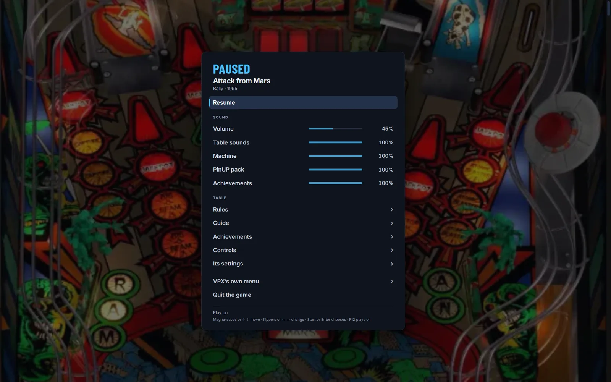
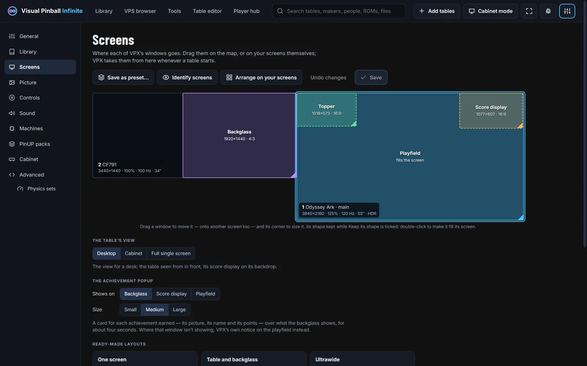
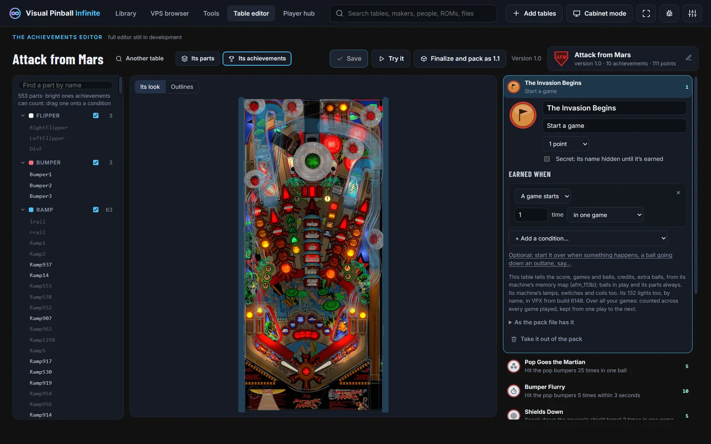

<p align="center"></p>

<h1 align="center">Visual Pinball Infinite</h1>

<p align="center"><strong>Everything around Visual Pinball X, in one app.</strong> Free and open source, for Windows 10 and 11.</p>

<p align="center"></p>
<p align="center"><sub>The library. Tables shown: AC/DC (LUCI Premium), Andromeda and Bad Cats by VPin Workshop, American Graffiti by Onevox, Scottacus, Leojreimroc, VPin Workshop and team. Pictures from the Virtual Pinball Spreadsheet.</sub></p>

Visual Pinball Infinite is a front end, a table and media manager and one place for every setting, for Visual Pinball X. Your tables play in VPX itself — VPX 10.9, or VPX 10.8.0 beside it — and the app does everything around them: it finds and sorts your tables' files, places your screens, sets VPX up, makes your tables' media, follows achievements live as you play, gives every game a pause menu with its rules and its guide, sets up VR, and browses the Virtual Pinball Spreadsheet. Future Pinball's tables can sit beside VPX's, played in Future Pinball through BAM, with the app as their front end too.

What's new: [the latest version's release notes](https://github.com/VPinInfinite/VisualPinballInfinite/releases/latest)

Questions, bug reports and ideas: the [Discord server](https://discord.gg/GyZTZtsJag) or this repository's issues.

## Download

The installer is on the [releases page](https://github.com/VPinInfinite/VisualPinballInfinite/releases): one file, installed for your Windows user, with no administrator rights needed. It needs Windows 10 or 11 (64-bit) and a DirectX 12 graphics card. Ten sample achievement packs are a download of their own beside it, and so is the achievements add-on, for VPX on its own.

It works with your own Visual Pinball X. Where your library has no VPX 10.9 yet, or an older build, Settings › Library's Get VPX downloads VPX 10.9.0 build 7001, the build the app is made for, and puts it beside the VPX you have, or in place of an older build, keeping every file it replaces so the VPX before can be put back. Tables, ROMs and media aren't included: get them from their authors. Nor are Future Pinball and BAM: where the app doesn't find them, Settings › Library links to their makers' pages.

VPX's team hasn't released 10.9 yet: build 7001 is one of its automatic builds of its newest code. An older test build of it, such as 10.8.1's build 5436, lacks the app's pause menu, multiball achievements, achievements from a table's lights, the score display placed in each backglass and the bass shaker. See [Which build of VPX](https://github.com/VPinInfinite/VisualPinballInfinite/wiki/Installing-and-first-setup#which-build-of-vpx).

## What it does

- **Plays your tables in VPX itself.** PLAY starts VPX with the table: VPX 10.9, or VPX 10.8.0 beside it, chosen for all your tables or one at a time. A table that stops at start in 10.9 is offered 10.8.0, and is tried again by itself in each newer VPX build. Your `.vpx` files play as they are and are never changed.
- **Future Pinball's tables too:** in your library beside VPX's, played in Future Pinball through BAM on your screens, with your sound outputs, keys and controller, the pause menu over them, their media recorded from the game, and their files put where Future Pinball reads them.
- **VR:** VPX's tables in a VR headset, through Meta Horizon Link, SteamVR, Virtual Desktop or another VR program, chosen in Settings › VR; the headset checked before a game, its resolution kept for each VR program, and the room you fitted kept from game to game. Every game, or one at a time with Play it in VR; Future Pinball's tables through BAM's VR.
- **Achievements, live as you play:** goals to earn from achievement packs made by a table's author or anyone else, followed as the game plays in VPX 10.9 and announced on the backglass or the score display, with a sound through VPX's own speakers. Hardcore while the table plays as its author made it, Softcore otherwise; multiball goals, and goals from a table's own lights. An achievements editor makes them by clicking the table's own parts.
- **A pause menu over every game:** started from the app, F12 or a controller's menu button pauses the game and shows the volume and a level for each part of the sound, the table's rules and instruction cards, its guide from Pinball Primer where the Spreadsheet links one, its controls and its achievements. In VPX 10.8.0 and Future Pinball too, without the volume and the levels.
- **1 to 4 screens:** the playfield, backglass, score display and topper placed by dragging them on a map or on the screens themselves, kept as presets to switch between, and a table can keep its own. The score display is placed in each backglass that has a window for it.
- **Your library:** each table's pictures, facts and designers from the Virtual Pinball Spreadsheet, favourites, ratings, playlists, a play log and high scores read from the machine's own memory, a Player hub with every table's high scores, your achievements and your stats, and a table with several table files shown once, its versions side by side on its page.
- **Adding tables:** drop in a download — a zip, 7-Zip or RAR archive (locked ones too, with their password), or a folder — and each file is told apart, matched to its table and shown where it'll go before anything moves, media placed one by one.
- **Finding what's missing:** the Virtual Pinball Spreadsheet's machines to browse, what each of your tables is missing, and tables recommended by what you play; a file's page opens inside the app, and what you download there is put in place with its table.
- **Your folders, as they are:** VPX's tables, ROMs, backglasses and PinUP packs, and your front end's media, where they already are. PinUP Popper, PinballX and PinballY keep starting VPX as they always have; the app keeps their media, ratings and game names in step with your library.
- **Settings in one place:** screens, picture, sound (a bass shaker too), controls, VR, ROM machines and PinUP packs on plain pages — each PinUP pack's layout chosen for your screens, VPX's own add-ons or the classic programs chosen part by part — saved into VPX's own settings, with every one of VPX 10.9's settings there when you want them. Future Pinball's games play with the screens, sound outputs and controls set there.
- **A table's script, made simple:** its options as switches and lists, or its whole script in an editor, checked before it's kept and saved beside the table, so the table file never changes.
- **Cabinet mode:** the app full screen across a cabinet's screens, tables chosen and started with the cabinet's buttons.
- **Media made for you:** a table's playfield, backglass and score display drawn by the app with no window, a preview video and a wheel, a Future Pinball table's recorded from the game; and a copy of a table with your own pictures in it, kept beside the original.
- **Tools for every table:** ROMs checked file by file, PinUP packs, media, color DMDs (colored by you, in a coloring program the app installs) and AltSound packs, made from a table's own ROM too.
- **A table inspector:** any table seen from above, drawn from its own parts, the first part of a table editor.
- **Report a problem:** your note, with the app's and VPX's logs and settings in one file you can look through first; the team's replies come back to the app, and you can answer them there.

<p align="center">




</p>
<p align="center"><sub>A table's page, the pause menu, the screens map and the achievements editor. Table: Attack from Mars, by JPSalas and team.</sub></p>

## Privacy

It goes online to read the Virtual Pinball Spreadsheet's database and pictures, to look for a new version on this repository's releases, and to read the team's short notice as it starts, if there is one. Nothing about you or your PC is sent with them. A file's page you open in the app, with Get, loads from its own site in a browser of the app's own, whose sign-ins stay on your PC until you sign out, and so do Future Pinball's and BAM's pages when you open them from Settings › Library. VPX is downloaded only when you click Get VPX: VPX's own automatic build, through nightly.link (a service that hands out GitHub's automatic builds without a sign-in), or VPX's newest automatic build where GitHub no longer keeps that one; a coloring program from its makers' own page only when you ask for it, and a table's guide from Pinball Primer only while you have it open, nothing of it kept. Report a problem gathers a file you can look through first, and sends it only when you press Send; then the app asks for the team's replies to it, with a key made on your PC for that report alone. "Use this PC's location", for the light of day in tables that follow it, asks Windows only when you click it.

## Building from source

On Windows 10 or 11, 64-bit, from the repository's folder:

1. **The tools.** This installs Rust, Visual Studio's C++ build tools, CMake, Ninja, Node.js, the GitHub CLI and MSYS2, asking once for administrator rights. The release tools also need [Python 3](https://www.python.org).
   ```
   powershell -ExecutionPolicy Bypass -File tools\setup\install-dev-tools.ps1
   ```
2. **The libraries**, each built from its source at the version its script pins, into `vpx-build\`, in this order:
   ```
   powershell -ExecutionPolicy Bypass -File tools\thirdparty\setup.ps1
   powershell -ExecutionPolicy Bypass -File tools\pinmame\setup.ps1
   powershell -ExecutionPolicy Bypass -File tools\altsound\setup.ps1
   powershell -ExecutionPolicy Bypass -File tools\libwinevbs\setup.ps1
   powershell -ExecutionPolicy Bypass -File tools\dof\setup.ps1
   powershell -ExecutionPolicy Bypass -File tools\dmdutil\setup.ps1
   powershell -ExecutionPolicy Bypass -File tools\libarchive\setup.ps1
   powershell -ExecutionPolicy Bypass -File tools\rom2altsound\setup.ps1
   ```
3. **The app's screens:** in `app\ui`, `npm ci --ignore-scripts`, then `npm run build`.
4. **The programs:** `cargo build --release`. They land in `target\release`; `vpi-app.exe` is the app, and `vpi_vpx_addon.dll` the add-on it puts into VPX for live achievements.
5. **The installer:** `tools\release\stage.ps1` gathers everything the installer installs and checks it, and `tools\release\installer.ps1` builds the installer. Its updates are signed with the project's key; for builds of your own, make a key with `tools\release\make-updater-key.ps1` and put its public key in `app\tauri.conf.json`.

A build of your own has no address for problem reports, which only the project's own builds are given: its Report a problem makes the file for you to attach to a post, and it asks nobody for replies or notices.

## Licence

GPL-3.0-or-later: see [LICENSE](LICENSE). Free for life: no price, no ads, no subscriptions. Every project it builds on is credited in [CREDITS.md](CREDITS.md), and the installer carries each one's licence in full.

## About

Made by VPinInfinite and Claude (Anthropic's AI). An independent project: not made by or affiliated with the Visual Pinball X team, Future Pinball's or BAM's makers, the Virtual Pinball Spreadsheet, Pinball Primer or any pinball maker. It's possible because they share their work. Machine names and artwork belong to their owners.

Takedown requests go to vpininfinite@gmail.com: we'll change or remove anything a table's author or a rights holder asks us to.
